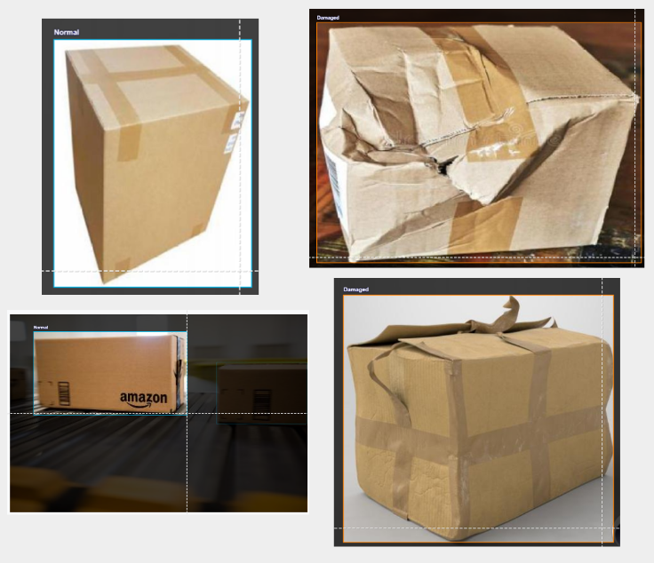
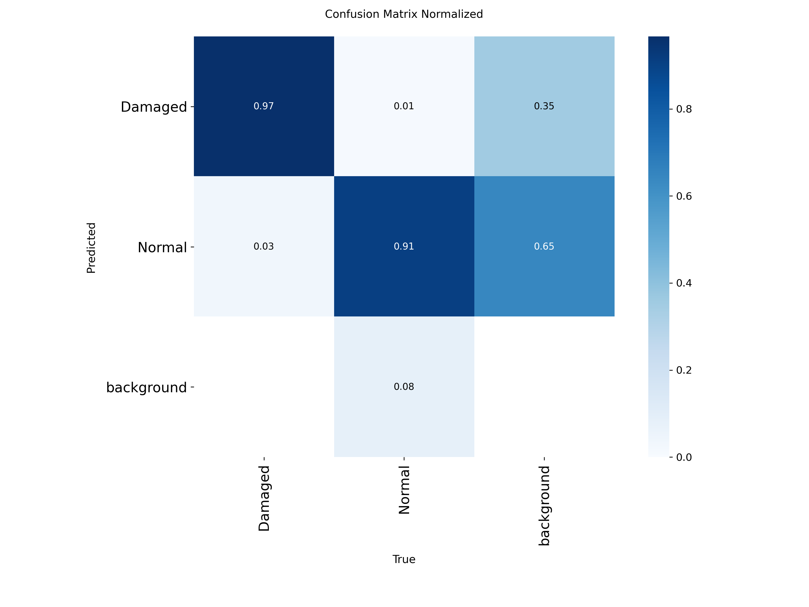

# Package Damage Detection Model

By: Evan Ancheta

## 1. Model Description

### Context
This project develops a YOLOv11 object detection model that detects damaged and undamaged shipping packages in images. 
The model predicts bounding boxes around packages and classifies each detected package as either damaged or normal.
Detecting package damage automatically could help logistics systems identify problems earlier in the shipping process. 
For example, warehouse monitoring systems could use a model like this to flag packages that may require manual inspection.

### Training Approach
The model was trained using YOLOv11 object detection within the Ultralytics framework. 
The model was fine-tuned from pretrained COCO weights and then trained on a custom dataset of package images.
Using pretrained weights allows the model to reuse general visual features learned from large image datasets before adapting them to the specific task of package damage detection.

### Intended Use Cases
Potential Applications of this model include:

- warehouse package inspection
- automated logistics monitoring
- research experiments involving object detection
- prototype quality-control systems

This model is intended for research and experimentation and should not be used as a fully automated system without human oversight.

---

## 2. Training Data

### Data Sources
The dataset used for training was created by combining two pre-annotated package detection datasets from Roboflow Universe:

https://universe.roboflow.com/nani-tmzf6/package-detection-5ozpr  
https://universe.roboflow.com/roboflow-ngkro/package-detection-e1ssd

These datasets contain images of shipping packages with bounding box annotations identifying package locations and damage conditions.

### Dataset Size

The combined dataset contains approximately **2,787 images**.

### Original Class Labels Across Datasets
Because the datasets came from different sources, they used slightly different label names. The original labels included:

- Box  
- Package  
- Box_broken  
- Open_package  
- damaged  

These labels were inconsistent across datasets and required standardization before training.

### Annotation Process
The dataset preparation process involved several steps:

- combined two pre-annotated datasets  
- standardized inconsistent class labels across datasets  
- verified bounding box annotations  
- reduced the number of classes  

After cleaning and relabeling, the dataset was reduced to two classes representing the condition of each package.

### Final Classes Used for Training

| Class | Count |
|------|------|
| normal | 1575 |
| damaged | 1212 |

The dataset is relatively balanced between damaged and undamaged packages.

### Train / Validation / Test Split

| Split | Ratio | Approximate Images |
|------|------|-------------------|
| Train | 70% | ~1951 |
| Validation | 20% | ~557 |
| Test | 10% | ~279 |

### Data Augmentation

The following augmentations were applied during training:

| Augmentation | Purpose |
|--------------|--------|
| Horizontal flip | simulate packages placed in different orientations |
| Image rotation | simulate packages rotated on the floor or conveyor |
| Brightness adjustment | simulate different lighting conditions |

These augmentations help the model generalize better to real-world environments.

### Known Biases and Dataset Limitations
The dataset contains mostly cardboard shipping boxes photographed under relatively consistent lighting conditions. As a result, the model may perform less reliably when detecting different packaging materials or under significantly different lighting environments. Some types of package damage may also appear less frequently in the dataset.

---

## 3. Training Procedure

- Framework: Ultralytics YOLOv11n
- Hardware: A100 GPU in Google Colab
- Epochs: 50
- Batch Size: 64
- Image Size: 640x640
- Patience: 50
- Training Time: ~7.44 minutes (446.58 seconds)
- Preprocessing: Augmentations applied at training time (see Data Augmentation section)

---

## 4. Evaluation Results

### Comprehensive Metrics

The YOLOv11 model was evaluated on a held-out validation dataset using standard object detection metrics. 
These metrics measure how accurately the model detects packages and classifies them as damaged or normal.

| Metric | Value |
|------|------|
| Precision | 0.927 |
| Recall | 0.919 |
| mAP50 | 0.959 |
| mAP50-95 | 0.868 |

Overall, the model achieves strong detection performance, with a high mAP50 score indicating that the model is able to accurately detect package locations and classify damage in most cases.

### Per-Class Breakdown

| Class | Images | Instances | Precision | Recall | mAP50 | mAP50-95 |
|------|------|------|------|------|------|------|
| all | 499 | 538 | 0.927 | 0.919 | 0.959 | 0.868 |
| damaged | 329 | 329 | 0.966 | 0.963 | 0.988 | 0.904 |
| normal | 170 | 209 | 0.887 | 0.876 | 0.930 | 0.832 |

The model performs slightly better at detecting damaged packages than normal ones. This may be because damage features such as dents or torn cardboard create stronger visual cues for the model.

### Visual Examples of Classes

The examples above illustrate typical images used during training. Damaged packages often contain dents, crushed corners, or torn cardboard, while normal packages appear structurally intact.

### Key Visualizations

#### Confusion Matrix

#### F1 Confidence Curve

#### Training Results

### Performance Analysis

Overall, the YOLOv11 model performs well for detecting packages and classifying them as damaged or normal. 
The high mAP50 score of 0.959 suggests the model is usually able to both locate packages and correctly classify their condition. 
The damaged class performs slightly better than the normal class, likely because visible damage such as dents or crushed edges creates stronger visual features that are easier for the model to learn.
The confusion matrix shows that most predictions fall along the diagonal, meaning the model correctly classifies the majority of packages. 
However, the matrix also highlights a background issue that is common in object detection models. In some cases the model predicts background where an object exists, meaning it misses a package entirely. 
This can happen when packages blend into the environment, appear small in the image, or have subtle visual features.
The F1-confidence curve shows that the model maintains strong performance across a range of confidence thresholds, with the best F1 score around 0.92. 
The training results plots also show that loss decreases and evaluation metrics improve steadily over the 50 training epochs, suggesting the model learned useful features without significant overfitting.
Overall, the model works well for clear package images, but performance may decrease when packages are partially occluded, poorly lit, or when damage is subtle.

## 5. Limitations and Biases

### Known Failure Cases

- The image above shows an example where the model predicts Damaged with a confidence of 0.85.
- The box shows minor deformation, but the damage is relatively subtle and could be interpreted differently by a human observer.
- The model appears to rely on visual cues such as bent edges, creases in the cardboard, or irregular box shapes when identifying damage.
- Because damaged packages in the training data often contain stronger visual damage signals, the model may sometimes overpredict the damaged class when it encounters boxes with minor wear or shipping creases.

### Poor Performing Classes

- The normal class performs slightly worse than the damaged class.
- Damaged packages often contain clearer visual features such as dents, crushed corners, or tears, which makes them easier for the model to recognize.
- Normal boxes can sometimes look visually similar to slightly damaged boxes or to background regions.

### Data Biases

- The dataset mainly contains cardboard shipping boxes, which limits how well the model can generalize to other package types.
- Other packaging formats such as padded envelopes, plastic mailers, or irregular parcels are not represented in the training data.
- Many images were collected in relatively controlled conditions, which may differ from real-world delivery environments.

### Environmental and Contextual Limitations

- Model performance may decrease when lighting conditions are poor or when strong shadows are present.
- Packages that blend into the surrounding background may be harder for the model to detect.
- Detection may also become more difficult when packages are partially occluded or appear very small in the image.

### Inappropriate Use Cases

- This model should not be used as a fully automated system for determining package damage in real-world logistics environments.
- Predictions should be reviewed by a human operator, especially when model confidence is low or when the damage is subtle.

### Sample Size Limitations

- The dataset used for training contains approximately 2,787 images across two classes.
- A larger and more diverse dataset would likely improve the model’s ability to generalize and reduce detection errors.